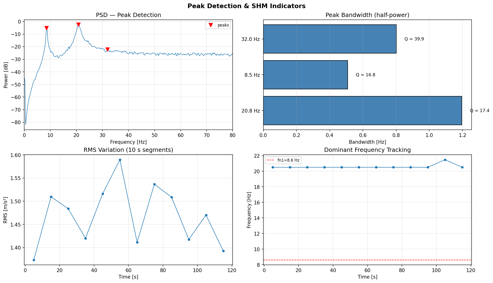

# Signal indicators

Signal-derived features that summarise a record, or follow how it changes over time: level, the shape of the amplitude distribution, and where the power sits in frequency. Useful for a first look at a record, for finding transients and changes of condition, and for trends.

`windowed_stats` computes all of them per window in one call; the functions after it are the single-feature versions.

---

::: dspkit.indicators.windowed_stats

---

::: dspkit.indicators.spectral_entropy

---

::: dspkit.indicators.kurtosis

---

::: dspkit.indicators.skewness

---

::: dspkit.indicators.rms_variation

---

::: dspkit.indicators.frequency_shift

---

::: dspkit.indicators.energy_variation
